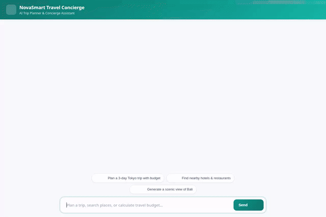

# ✈️ NovaSmart Travel Concierge (`travel-planner-agent`)

An agentic AI Travel Concierge Assistant built with Google's **Agent Development Kit (ADK)** and deployed on **Vertex AI Agent Runtime**. NovaSmart Travel Concierge helps travelers plan custom itineraries, check live weather, discover local amenities, generate postcard media, calculate travel budgets via sandboxed code execution, and maintain long-term session memory for dietary preferences and allergies.



---

## 🛠️ Implemented Architecture & Google Cloud Integration

The agent is implemented in `app/agent.py` and configured via `agents-cli-manifest.yaml`. It leverages the following Google Cloud and ADK services:

- **Vertex AI Reasoning Engine / Agent Runtime**: Deployed agent host servicing A2A (Agent-to-Agent) protocol requests.
- **Vertex AI Memory Bank & Cloud Firestore**: Cross-session long-term memory (`PreloadMemoryTool` and `generate_memories_callback`). Automatically extracts, stores, and recalls user preferences, dietary restrictions, and health/food allergies across conversations.
- **Google Cloud Storage (GCS)**: Public media bucket storage (`travel-planner-media-qwiklabs-gcp-02-0420cd5f6f8a`) hosting generated destination images and videos.
- **Vertex AI Imagen 3**: `generate_destination_image` generates high-resolution destination images (`imagen-3.0-generate-002`), saves them as session artifacts, and uploads public URLs.
- **Google Omni Model (`gemini-omni-flash-preview`)**: `generate_destination_video` creates short video clips via global region Interactions API, saving session artifacts and public GCS URLs.
- **Agent Engine Sandbox Code Executor**: `AgentEngineSandboxCodeExecutor` executes Python code in a secure cloud sandbox for budget calculations, math, and dynamic data analysis.
- **A2UI Schema Renderer**: `a2ui_callback` converts agent outputs into native structured visual cards, columns, rows, text, and images.

---

## 🧰 Agent Tool Capabilities

| Tool Name | Capability & Integration |
|---|---|
| `PreloadMemoryTool` | Preloads cross-session user memories and food/allergy preferences from Vertex AI Memory Bank. |
| `get_weather` | Fetches real-time weather forecasts and temperature using the Open-Meteo API. |
| `get_current_time` | Retrieves current local time for any specified timezone. |
| `get_destination_info` | Provides destination highlights, currency, and essential travel tips. |
| `get_live_city_info` | Queries live city amenities, cafes, transit, and sights via the Overpass OpenStreetMap API. |
| `geocode_address` | Converts addresses into latitude and longitude coordinates using OpenStreetMap Nominatim. |
| `search_nearby_places` | Searches for nearby points of interest around target coordinates. |
| `generate_destination_image` | Generates destination artwork via Vertex AI Imagen 3, saving artifacts and GCS public URLs. |
| `generate_destination_video` | Generates short destination videos via Google Omni model (`gemini-omni-flash-preview`), saving artifacts and GCS public URLs. |
| Python Code Execution | Runs sandboxed Python code for custom itinerary math, budget modeling, and currency conversions. |

---

## 📌 Planned / Future Enhancements

The following features were outlined in initial design concepts but are **not yet implemented** in the current code release:

- **Live Flight Booking & GDS API Integration**: Real-time flight search and booking execution via external airline APIs.
- **Hotel Reservation Engine**: Live hotel room inventory lookup and booking integration.

---

## 🚀 Setup & Local Run Instructions

### Prerequisites
- Python 3.10+
- `uv` or `pip`
- Google Cloud SDK (`gcloud`) authenticated to your GCP Project with Vertex AI enabled

### 1. Install Dependencies
```bash
pip install -r app/requirements.txt
pip install -r frontend/requirements.txt
```

### 2. Set Environment Variables
Set your deployed Agent Engine resource name and agent directory:
```bash
export GOOGLE_CLOUD_PROJECT="<your-gcp-project-id>"
export AGENT_ENGINE_RESOURCE_NAME="projects/<project-id>/locations/<region>/reasoningEngines/<engine-id>"
export AGENT_DIRECTORY="app"
```

### 3. Run the Frontend Locally
Navigate to the `frontend/` directory and run the FastAPI proxy server:
```bash
cd frontend
python main.py
```
The server will start on port `8080`.

---

## 📦 Deployment Instructions

### Deploy Agent to Vertex AI Agent Runtime
```bash
agents-cli deploy
```

### Deploy Frontend Proxy to Cloud Run
```bash
cd frontend
gcloud run deploy travel-planner-frontend \
  --source . \
  --region us-east1 \
  --allow-unauthenticated \
  --set-env-vars="AGENT_ENGINE_RESOURCE_NAME=$AGENT_ENGINE_RESOURCE_NAME,AGENT_DIRECTORY=$AGENT_DIRECTORY"
```
